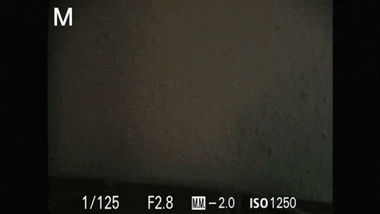

> # Update on How To Install 2026-11-21

In the past this app needed to be installed throuh the pmca-gui application from [https://github.com/ma1co/Sony-PMCA-RE], which hasn't been updated in 4 years.

**This app can nowadays also immediately be consumed and used (=directly installed via usb) through [pmca-re-reloaded](https://github.com/masterflai/pmca-re-reloaded) as well.**

> Adding to ma1co's OpenMemories app - so that it would be in the app list by default for users - was possble for many years by opening a pull request to https://github.com/ma1co/OpenMemories-AppList/pulls - mine (and others) hasn't been answered for 3 years now.  
> However the idea on OpenMemories was picked up by @masterflai and his pmca-re-reloaded project so be sure to check it out as well :)
> I haven't updated the README below, expecting that you'd read this update first. The old way on how to install it also still works so I leave it as it is.
> Anyone is appreciated to pick up the work on this repo, e.g. implementing the [user suggestions](https://github.com/dired/PMCA-HDMICam/discussions/3), as I currently don't have the time for it.  

---

# PMCA-HDMICam

OpenMemories is a Framework hosted by @ma1co that allows to build PlayMemories Camera Apps (PMCA). PMCAs are Sony's android app format, supported by a wide range of Cameras that were released by Sony from 2012-2016.

This is such a custom PCMA, an OpenMemories App, that you can install using @ma1co's easy-to-use installation tool [Sony-PMCA-RE](https://github.com/ma1co/Sony-PMCA-RE).

## Introduction

Were you - just like me - blindly buying the Sony DSC HX400V, expecting that "HDMI Out" means you can expect a full-hd output that can be recorded (e.g. to use it as a webcam)?

Were you just like the next guy feel the need to tell others that that sony camera DOES NOT have clean hdmi output? [https://www.flickr.com/groups/2549878@N23/discuss/72157664988567388/]

Were you looking for *any way* to get HDMI Output on your HX300 without any text or menu overlays? (which I read somewhere else)

**LOOK NO FURTHER**

This solution delivers you CLEAN HDMI Output for all cameras that support Sony's PlayMemories Camera Apps (see [Supported Devices](#supported-devices)).

Also about that **E:62:10** error, did that also get in your way?
**It's gone!** Wait what really? YES ITS GONE! At least if you were planning to use your camera for it's HDMI Output only.
I made a proof video:

### Preventive information
On some cameras, like the A5000 (and I think I read someone found out about the HX200V), a clean HDMI output can also be achieved through another method: by writing a value to a specific memory address of the device. If this is not too much of a hastle for you, it may be a "more satisfying" solution?

In case of my HX400V I have not found for certain to what adress I have to write, nor am I keen on digging that deep.
In case you want to dig deeper, without any guarantee from me that you will get the same thing with just more effort, see (this thread)[https://github.com/ma1co/OpenMemories-Tweak/issues/70].

## Features / Use-Cases

The killer feature is the clean HDMI output. Before, people were using the non-clean output and cropping the text away / using an even smaller resolution that shows black bars where the text is. Keep in mind that since Sony did not officially support clean HDMI in the first case for your camera, the support by the firmware (meaning the settings you have in the menu) is limited, and the resolution is probably fixed to 4:3 (the sensor's ratio) and lower than what you would get when you would record a video with the camera in the normal way (all this depends heavily on your model, I can only speak for my HX400V). Also ***you must know that at this moment in time, no settings (ISO etc.) are available during / after entering the clean HDMI "mode"***, except for zooming and triggering autofocus/finder by pressing the trigger half-way through. (note to myelf: test if settings from manual mode persist in the app)

The main use-case in my eyes is that you could can use the clean hdmi output as a webcam. This is actually a killer-feature, making all those "old" sony cams useable again for streaming, surveillance, timelapse, fixed-camera-use-as-you-name-it.
Simply buy a "hdmi to usb video capture card", a "HDMI-Micro-D to HDMI-A Cable", possibly a "dummy battery for sony NP-BX1" to use it with a power supply instead of a battery.
I myself bought a cheap hdmi to usb 3 video capture card grapper with 1080 resolution and supposedly 60fps (although I don't need more than 720 resolution and 30fps because of the HX400V's output) for 17€, the cable for 2,06€ and the dummy battery for 8,59€. (The HX400V I got used for 115€)

## Installation

1. Download the pmca-gui application from [https://github.com/ma1co/Sony-PMCA-RE] (Releases-Page). For me it was pmca-gui-v0.18-win.exe
2. Download the .apk from this repository's Releases-Page. [https://github.com/dired/PMCA-HDMICam/releases]
3. Connect the Camera via USB and make sure the camera is powered on.
4. Start the pmca-gui application.
5. Inside the pmca-gui v0.18, press "Get camera info" without any purpose except for you to see valid output - the text-box below should show your camera model and some other info.
6. Inside the pmca-gui v0.18, go to tab "Install app".
7. Inside the tab "Install app", click on "Select an apk", then click on "Open apk...". In the file dialogue, navigate to and open the downloaded .apk from this repository's Release-Page.
8. After the field "Select an apk" is filled out with the path to the file you provided in the last step, click on "Install selected app".
9. Observe the text-box below to successfully complete the installation. (For me, on the camera, it also quickly shows a screen about installing app)
10. When the installation is completed, you can actually just plug out your camera from USB. Go to the Menu, to the Application List, and start "PMCADemo", then inside start "Camera (note to myself: change the name from PMCADemo to PMCA-HDMICam - although not of great important since I mentioned it now here)

You can also, instead of plugging out the camera just yet, think about installing some of the (other OpenMemories-Apps)[https://github.com/ma1co/OpenMemories-AppList/blob/master/apps.yaml]. Those are all more easily available in the field "Select an app from the app list" of the pcma-gui's tab "Install app". For example you could get rid of the NTSC nag screen and Remove the 30min video recording limit - other killer features in that case of the PMCA (OpenMemories-Tweak)[https://github.com/ma1co/OpenMemories-Tweak].

## Usage

After having the Installation completed, and your camera unplugged, go to the Menu and start the App. (Menu -> Application List -> PMCADemo (sic!))
Inside the PMCADemo-App, you can select several features from a menu.
Select Camera.
Inside the Camera-"feature", you have your clean HDMI-Output! Without the E:26:10 error, as promised.

Now, the things you can do are limited:
* Zoom
* Half-press the shutter button to focus
* Fully press the shutter button to take a picture (it is saved on your SD card just as if you had taken it outside of Android)
* Press the trash button to exit
* If you power off the camera while in that mode, when starting PMCADemo from the Application List, it will directly start in that mode (you then don't need to select "Camera" first)

(If you look for explanations on the other features that have nothing to do with HDMI, see the (PMCADemo Readme)[https://github.com/ma1co/PMCADemo].)

### Note for clarification
Of course, as you can now see, we are focussing on one feature of an existing app, @ma1co's original (PMCADemo)[https://github.com/ma1co/PMCADemo]. Why not just use the orignal instead? Because in that case, if you enter "Camera", you don't get a fully clean HDMI output - a bar persists at the top that says "Camera" (as you would usually expect, just that it can't be toggled off).

I am not the first that noticed that it would be huge to get rid of that bar, in fact there are two repositories that were also just created for that purpose.
It was even explained exactly by @ma1co what changes are need to be done, just noone released an apk accordingly.
With one exception of @lucaspape who released an apk in his PMCA-CleanHDMI repo, about which he said that the camera quality is somehow bad, which I could not confirm, but I noticed the "Half-press of shutter button to focus" to be done.

I have described all my research and ongoings in the (Pull Request by @judgemento of the original PMCADemo repo)[https://github.com/ma1co/PMCADemo/pull/14], that is Open since 30 Oct 2018. (!)

I believe, since @ma1co is actively maintaining the (pmca-gui/pmca-console, or to be precise the Sony-PMCA-Reverse-Engineering)[https://github.com/ma1co/Sony-PMCA-RE], he just has better things to do than incorporate that pull request that would really complicate the whole design of a simple app (all features have that menu bar. should the bar be hidden on the other featuers as well? via a toggle? why? etc.).

All that has lead me to thinking, why would no-one make this a bigger thing?
A lot of people have maybe stopped using their devices for the error e:62:10 alone. Now they can use their old cameras again as webcams.
Even if you don't have the error e:62:10 (which is I think unlikely :D if you consider [https://web.archive.org/web/20190317105122/http://sony-e-62-10.tk/]), it gives you a new range of opportunities to use your device, by being able to record/monitor from HDMI cleanly.

Hence we here have this dedictated repo. It's whole purpose is for now to at least give the normal everyday user a simple step-by-step installation (see [#installation]), and a ready-to-install .apk that he can us within the process (see Releases-Page). Then she/he can use the camera as a webcam or whatever as-is, good enough - (i think this is already much nicer to have this way). End of the story for now.

## Feedback / Contribution

Of course if you encounter problems that don't go beyond what I promised (otherwise I will let you know), feel free to write an Issue, open a discussion, or commit the change yourself.

I don't have any problems. I am recording for the whole time while I am creating this repository since I have it working like 4 hours ago (even on battery, not power supply). Clean HDMI out, app doesn't crash or whatever, all I hoped for and needed!

Most important thing for you to know: I am not an android developer, nor have I used Java otherwhere then in university (I am good in c/c++/python/javascript). It was already a struggle for me to compile the project and have a built apk that runs on the camera (although I surely made it more complicated to myself than it is for android-devs).
I am ready to take on some background / coordinating responsibilities (like accepting merge requests, that would include testing your changes on my HX400V), if there is activity, which is not what I really expect :D

I am not ready to e.g. buy more cameras that I don't havfe to test model-specific "border"-features or verify (e.g. according) merge requests for which I have not the space/time, or similar stuff that would make this some kind of half-time job.

In case you would like to develop this a little, I already have some things in mind:
* Making settings available. As I understand, a sony library is used (see line 6 of file CameraActivity.java) for opening the camera-preview, autofocussing, and taking a picture (because this is what the original intention of that feature was). If we could simply incorporate the other buttons, that are already easily available in other places in the code, and map them to whatever features the sony library can offer. I have not checked the documentation, to find out what other functions are offered. It would already be huge to trigger some of the functions in a intuitive way (e.g. a button cycles through iso, another button toggles the manual focussing of the ring, etc.). I myself don't need more settings so far, hence will not develop this but would love to meet someone who does.
* Cleaning away the stuff from PMCADemo we don't need - talking about all the other features except "Camera", and the overarching menu that lists other features. I personally don't have a problem with keeping this (since it starts with "Camera" anyway, if you don't exit it via trash-button - so no time-saver) but it is actually unnecessary and should not be here in the HDMICam PMCA if you think about it. Feel free to throw that garbage away, I would like it if someone feels free to do that.
* Maybe instead of throwing away the overarching menu, have the item "Camera" and another useful item "Settings" - this bullet point is about a potential "Settings"-menu. It could offer the settings from the camera's original menu, that relate to HDMI, like output resolution (for me 1080p and 1080i, although it's not what I really get :D). Maybe this would also be a better option to change/keep image settings like ISO. If you like, have a go. Let's work on it together :)
* Offering the A5000- and other available memory-"hacks" that are valid for some devices and relate to HDMI. E.g., as I read, connecting to the a5000 via telnet (can be enabled in the PMCA OpenMemories Tweak) and issuing a `bk.elf w 0x01070a47 00` results in a clean hdmi output with 1080p resolution [https://github.com/ma1co/OpenMemories-Tweak/issues/70#issuecomment-799567832]. Other hacks, like for the HX200V I believe I read somewhere, exist. And this App could be a great place to unite them and make them easily accesible via an option in e.g. a "Settings"-Menu of the HDMICam PMCA. I don't know though, if writing memory is possible from user space / from the running android app - If someone thinks this is a good idea, you have me lost, but as I said I would support as much as is in my power 
* ~~Adapting the build system to properly reflect the current version dynamically (as you can see it's all dirty right now). Generally cleaning up the project, as would be good from a devops but also gradle expert's perspective. If there is no further activity, I don't mind keeping it as is, otherwise, I will do the cleanup as good as I can myself firstly.~~ -> *done in v0.2*
* ... (other ideas?)

All in all I think it's a nice idea, given the wide ranges of supported devices. Although, on the other hand, these devices are as old as ranging from 6 to 10 years. People maybe just bought a new camera in the meanwhile. On the other hand, many people might not be buying a new camera so often, still using their "old" cam from time to time, or see this and think it's a cool idea to give their old camera to their kid as a webcam. 

I don't know how much this will actually "help", but that is what my foremost intention is with this. If you come across this and just need help to get this to run, wanting to use your old camera again but it is already cumbersome enough for you to figure out what to do "now": register to github and make an entry on the "Issue"-page. I can gladly make a tutorial video on the installation, or things like that if enough people are requesting it.

## Build Process / Compilation
This was the thing that took me the most time. But the way I changed the PMCADemo master, according to the (answer in @JoJ123's posting)[https://stackoverflow.com/questions/57127685/how-to-build-old-android-project-in-android-studio], and then some kind of migrate process, the code as is for me runs with the current android studio, without that I had to do anything beyond the standard procedured.

**Instructions only for Windows.**
I did this finally on Windows after some efforts with Linux. So I can give you only instructions for that OS.

Here is what I did:
* Download (Android-Studio)[https://developer.android.com/studio] (for the reference:  Android Studio Chipmunk | 2021.2.1 Patch 2 for Windows 64-bit (929 MiB) )
* Install Android Studio
* (annoyingly requires a registration, and I don't even know if it wasnecessary!) Press Download here after registering https://developers.redhat.com/products/openjdk/download
* Extract the zip to a "permanent location", and add the /bin directory to the PATH (google 'windows environment variables' if you don't know)
* Clone the repository to a location of your liking
* Open Android Studio
* After finishing the setup (all defaults), installing some sdks after accepting some licenses, "open" an existing project
* Locate and open the cloned repository, accept / go through any assistants if any come up
    => Because of the defined targetSdkVersion, compileSdkVersion, minSdkVersion, distributionUrl - the build environment should be "taken over" and be exactly as it is here with me.
* It will sync the project with gradle, some things are downloaded, it should turn out ok. (Otherwise please let me know)
* You can click on the little hammer symbol in the middle of the top bar left to "app", to "Make Project. Click on it and it will build.
* Building can be observed in the "Build Output" at the bottom (should come up automatically). It should turn out ok, even though a red note comes up "Some input files use or override a deprecated API. \ Recompile with -Xlint:deprecation for details." (you can ignore this).
* The built .apk resides in your projects app/build/outputs/apk/debug/app-debug.apk - you can install that with pmca-gui.

Now that I looked at SDK Manager from the "Tools" Menu in the Title Bar, I remember that I installed "Android 10". But I don't think that this makes any difference, since the project is using Android 2.3.3 (afair an installation assistant for that SDK platform comes up when opening the project the first time, otherwise you need it installed in SDK Manager).

Just to make sure: 
Clicking "File" in the title bar, then "Project Structure" (Ctrl+Alt+Shift+S), in the "Project" tab, it shows:
* Android Gradle Plugin Version: 7.2.2
* Android Gradle Version: 7.3.3

What confused me the most is how the compatibility works between gradle and the old gingerbread platform (android 2.3.3). But it seems to work like this, nothing to worry.

Let me know if it doesn't work for you.

## Supported devices

This is the list of devices supported by @ma1co's OpenMemories-Framework, which is the underlaying framework for all OpenMemories PCMAs.
Here I list all supported devices as you can also find them listed at [OpenMemories-Framework Cameras.md](https://github.com/ma1co/OpenMemories-Framework/blob/master/docs/Cameras.md) and [https://openmemories.readthedocs.io/devices.html](https://openmemories.readthedocs.io/devices.html):

| Camera Model |
| --- |
| NEX5R |
| NEX6 |
| NEX5T |
| A7 |
| A7R |
| A5000 |
| AS100V |
| A6000 |
| HX60 / HX60V |
| HX400 / HX400V |
| A7S |
| RX100M3 |
| A5100 |
| QX1 |
| QX30 |
| AZ1 |
| A7M2 |
| CX440 / CX480 / PJ410 / PJ440 |
| CX620 / CX670 / PJ620 / PJ670 |
| AX30 |
| AX33 |
| AS200V |
| X1000V |
| HX90 / HX90V |
| WX500 |
| A7RM2 |
| RX10M2 |
| RX100M4 |
| A7SM2 |
| RX1RM2 |
| CX450 / CX455 / CX485 |
| CX625 / CX675 / CX680 / PJ675 / PJ680 |
| AX40 / AX55 / AXP55 |
| AX53 |
| AS50 |
| A6300 |
| HX80 |
| RX10M3 |
| AS300 |
| X3000 |
| RX100M5 |
| A6500 |
| DSC-HX60 |
| DSC-HX90 |
| DSC-HX400 |
| DSC-RX1RM2 |
| DSC-RX10M2 |
| DSC-RX10M3 |
| DSC-RX100M3 |
| DSC-RX100M4 |
| DSC-RX100M5 |
| DSC-WX500 |
| FDR-AX30 |
| FDR-AX33 |
| FDR-AX40 |
| FDR-AX53 |
| FDR-AX55 |
| FDR-AXP33 |
| FDR-AXP35 |
| FDR-AXP55 |
| FDR-X1000V |
| FDR-X3000 |
| HDR-AS50 |
| HDR-AS100V |
| HDR-AS200V |
| HDR-AS300 |
| HDR-AZ1 |
| HDR-CX405 |
| HDR-CX450 |
| HDR-CX625 |
| HDR-CX670 |
| HDR-CX675 |
| HDR-CX680 |
| HDR-PJ410 |
| HDR-PJ670 |
| HDR-PJ675 |
| ILCE-7 |
| ILCE-7M2 |
| ILCE-7R |
| ILCE-7RM2 |
| ILCE-7S |
| ILCE-7SM2 |
| ILCE-5000 |
| ILCE-5100 |
| ILCE-6000 |
| ILCE-6300 |
| ILCE-6500 |
| ILCE-QX1 |
| NEX-5R |
| NEX-5T |
| NEX-6 |

# Thanks
I deeply thank everyone that made the PMCA-RE a reality. Your efforts are worth much more than what a new camera would have cost me <3
